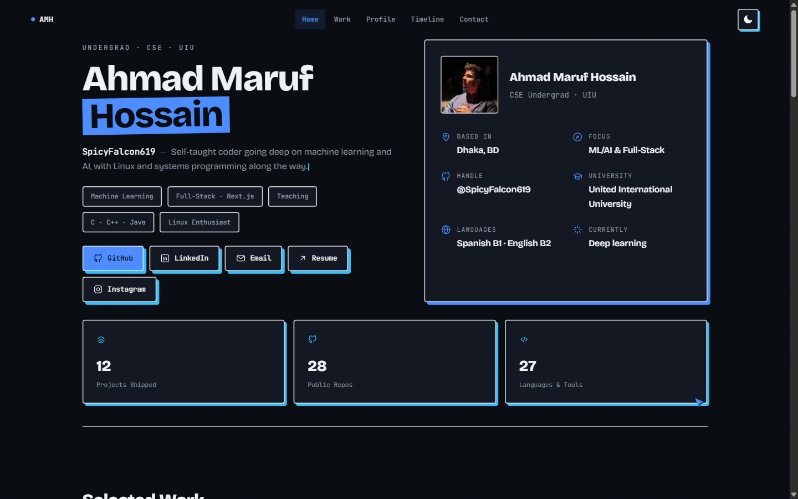

# Ahmad Maruf Hossain: Portfolio

The personal portfolio of **Ahmad Maruf Hossain (SpicyFalcon619)**: a CSE undergraduate at United International University, Undergraduate Assistant for the Database Management System Lab, and builder of Nestly, the Field Guides and Drawer 378.

**[spicyfalcon-portfolio.vercel.app](https://spicyfalcon-portfolio.vercel.app)** · [Résumé (PDF)](https://spicyfalcon-portfolio.vercel.app/resume.pdf) · [Desktop-style version](https://spicyfalcon-os.vercel.app)



## What's on the site

| Section | Contents |
|---|---|
| **Home** | Name, focus, links (GitHub, LinkedIn, email, résumé) and a profile card with live GitHub numbers |
| **Selected Work** | Twelve projects in an index: pick one to read what it does, its stack, and its live link or repository |
| **Profile** | About, highlights, the full tech stack, and a GitHub contribution heatmap built from real data |
| **Timeline** | Milestones: the UGA role, competitions, education |
| **Contact** | Email, a contact form, social links and the CV download |

## Design decisions

- **Neo-brutalist, not templated.** Solid panels, 2 px borders, hard offset shadows and sharp corners. Glassmorphism, bento grids and particle backgrounds were tried and dropped because they looked generic.
- **Real data only.** [`src/lib/github.ts`](src/lib/github.ts) reads public repository stats from the GitHub REST API and the contribution calendar from GitHub's own page, then draws the heatmap as a plain CSS grid, refreshed hourly. Every project links to a real repository or live deployment.
- **The CV is one click away everywhere.** A Résumé button in the top bar, in the mobile menu, in the hero and in Contact. The public PDF leaves out the phone number.
- **Built for every screen.** The top bar folds into a slide-down menu under 760 px; the custom cursor switches itself off on touch devices.
- **Light and dark themes**, class-based, with no flash on load.

## Tech stack

| | |
|---|---|
| Framework | Next.js 15 (App Router), React 19, TypeScript |
| Styling | Plain CSS with custom properties; no utility framework |
| Motion | Framer Motion, `react-type-animation` |
| Fonts | Bricolage Grotesque and JetBrains Mono via `next/font` |
| Theming | `next-themes` |
| Data | GitHub REST API, revalidated hourly |
| Analytics | Vercel Analytics and Speed Insights |
| Hosting | Vercel, deployed on every push to `main` |

## Run it locally

```bash
npm install
npm run dev        # http://localhost:3000
npm run build && npm start
```

Node.js 18 or newer. No environment variables are needed; GitHub data comes from public endpoints.

## Project structure

```text
src/
  app/
    layout.tsx         fonts, theme provider, metadata, analytics
    page.tsx           fetches GitHub data and composes the sections
    globals.css        design tokens and all styling
  components/
    TopBar.tsx         sticky navigation, résumé link, mobile menu
    Hero.tsx           name, tagline, profile card, stats
    ProjectIndex.tsx   Selected Work: the project list and detail view
    InfoPanels.tsx     about, highlights, tech stack, GitHub activity
    GitHubHeatmap.tsx  contribution calendar from real data
    Timeline.tsx       milestones
    ContactCTA.tsx     contact form, socials, CV download
  lib/
    github.ts          GitHub REST fetch and contribution scraper
public/
  resume.pdf           the public CV
  assets/              avatar, icons, preview image
```

## Updating the content

Projects live in `PROJECTS` in [`src/components/ProjectIndex.tsx`](src/components/ProjectIndex.tsx), highlights and the tech list in [`InfoPanels.tsx`](src/components/InfoPanels.tsx), and milestones in [`Timeline.tsx`](src/components/Timeline.tsx). To update the CV, replace `public/resume.pdf`.

## License

The code is [MIT licensed](LICENSE). The text, photographs and CV are personal and not covered by the licence.
